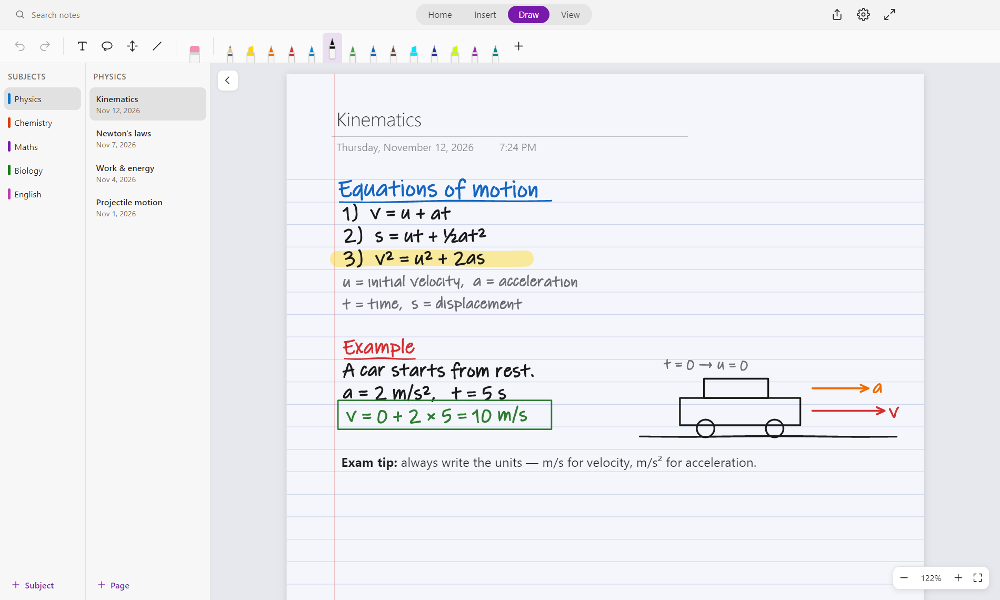
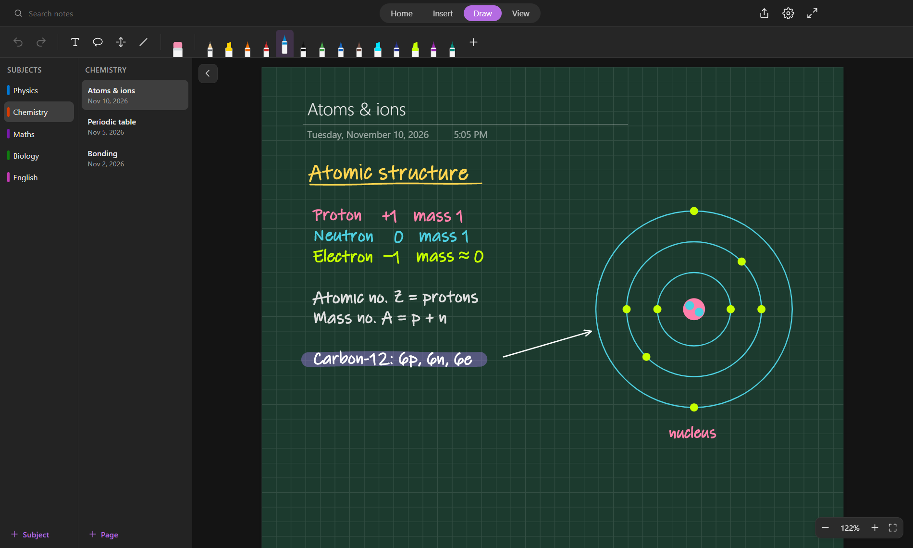
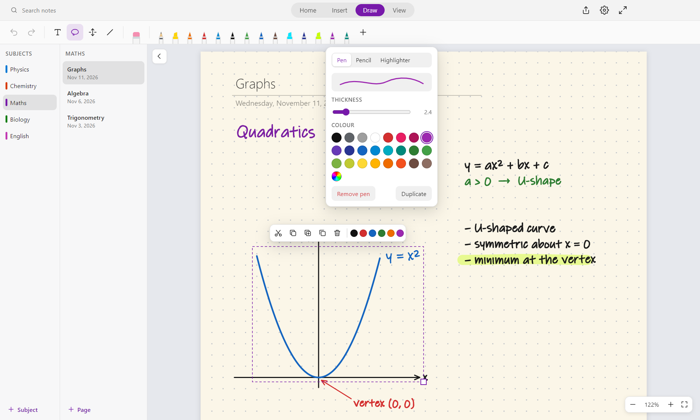
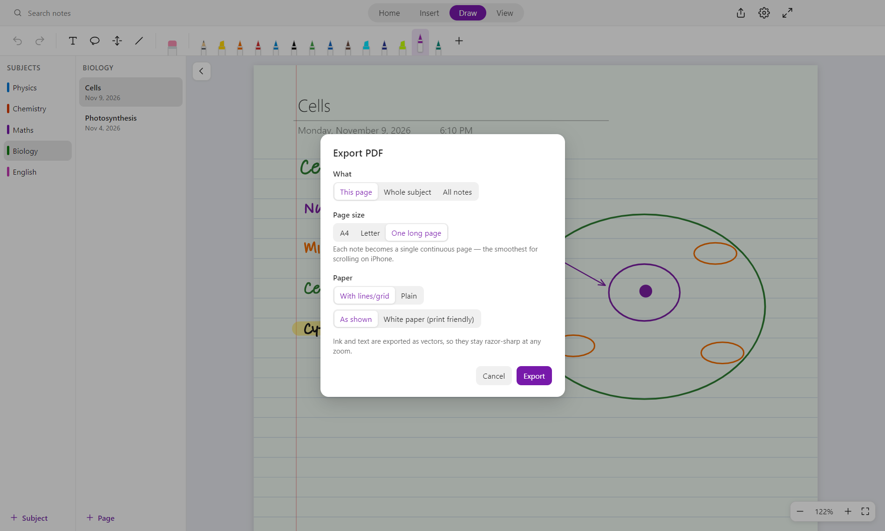

# InkNote

A pen-first note-taking board for Windows — OneNote-style pages, smooth pressure-sensitive ink, and crisp vector PDF export (great for reading your notes later on a phone).

Built with Electron and plain JavaScript (no framework).



<table>
  <tr>
    <td width="50%"><br><sub><b>Dark theme</b> — chalkboard paper, dark ink auto-brightens</sub></td>
    <td width="50%"><br><sub><b>Lasso &amp; pen options</b> — move, recolour, copy; pick colour &amp; thickness</sub></td>
  </tr>
  <tr>
    <td colspan="2"><br><sub><b>Vector PDF export</b> — A4, Letter, or one long page for smooth scrolling on a phone</sub></td>
  </tr>
</table>

<sub>All handwriting in these screenshots is drawn by InkNote's own ink engine.</sub>

## Features

- **Smooth ink** — custom ink engine: jitter-free strokes (lag-free arc-length smoothing + 1€ filter), even pressure-sensitive width, round joints. Works with pen tablets such as XP-Pen / Wacom (enable *Windows Ink* in the tablet driver for pressure).
- **Pens, pencil & highlighters** — click the active pen again to change colour/thickness; add your own pens.
- **Erasers** — stroke eraser and point (partial) eraser; the pen's eraser end / barrel button erases too.
- **Hold to straighten** — pause with the pen down and the stroke snaps into a straight line.
- **Lasso select** — move, resize, recolour, copy/paste, duplicate, delete.
- **Text boxes, pictures (paste / drag & drop), shapes** (line, arrow, rectangle, ellipse), **insert space**, date stamp.
- **Paper** — plain, ruled, narrow, wide, grid, dots; 11 paper colours; margin line; light/dark theme (dark ink auto-inverts on dark paper).
- **Zoom** — Ctrl + wheel, touchpad pinch, two-finger touch, page-width fit.
- **Subjects & pages** sidebar with search (titles + typed text).
- **PDF export** — vector ink and real text; A4, Letter, or *one long page* per note; optional white “print-friendly” paper.
- **Auto-save** to `Documents\InkNote\notebook.json` with daily backups, plus backup/restore.

## Run from source

```bash
npm install
npm start
```

## Install on Windows

```bash
npm install
npm run icon
node tools/make-ico.js
powershell -ExecutionPolicy Bypass -File tools\install-windows.ps1
```

This installs InkNote to `%LOCALAPPDATA%\Programs\InkNote` on top of the official signed Electron runtime and creates Desktop + Start-menu shortcuts. It works even when Windows **Smart App Control** is on (which blocks unsigned `.exe` files).

To build a regular installer / portable `.exe` instead (needs code signing to run under Smart App Control):

```bash
npm run dist
```

## Shortcuts

| Key | Action |
| --- | --- |
| P / E / L / T / S | Pen / Eraser / Lasso / Text / Shapes |
| 1–9 | Select pen 1–9 |
| Space + drag, middle-drag | Pan |
| Ctrl + wheel, Ctrl + / − / 0 | Zoom / fit width |
| Ctrl+Z / Ctrl+Y | Undo / Redo |
| Ctrl+C / X / V / D, Del | Copy / Cut / Paste / Duplicate, Delete |
| Ctrl+E | Export PDF |
| Ctrl+N | New page |
| F11 | Full screen |

## License

MIT. Includes [perfect-freehand](https://github.com/steveruiz/perfect-freehand) (MIT, © Steve Ruiz), used to render strokes made with older versions.
